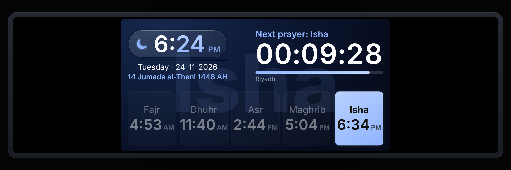
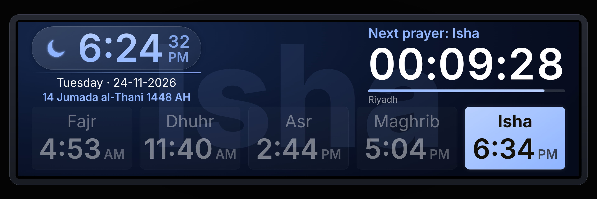

# Prayer Times Widget for CORSAIR XENEON EDGE

Prayer times on the CORSAIR XENEON EDGE, all in one widget. It shows the clock, the Gregorian and Hijri dates, the five daily prayers and a live countdown to the next prayer, with a progress bar and a card for every prayer.

The countdown turns red during the last 30 seconds, and when the prayer time starts a circle counts down 15 minutes to the iqama. In the widget settings you can choose your city, the prayer times source, the calculation method, the language, and the background. It comes in four sizes (S, M, L and XL) and it is built for touch screens.

## Features

- Five daily prayers with a live countdown and a progress bar to the next one
- Red countdown in the last 30 seconds, and a 15 minute iqama circle when the prayer time starts
- Gregorian and Hijri (Umm al-Qura) dates, 12 or 24 hour clock
- Three prayer times sources: AlAdhan, eSalah and an offline local calculation, with automatic fallback
- Automatic location (device location, then internet, then time zone), 255 ready-made cities, or any city in 196 countries
- 10 calculation methods, with standard or Hanafi Asr, and an Automatic mode that uses ISNA in the United States and Canada and Umm Al-Qura elsewhere
- 29 languages that follow your Windows language by default, including right-to-left languages
- Seven backgrounds that change with each prayer, one fixed background, or a custom color
- Four sizes: S, M, L and XL

## Screenshots

| S | M |
| --- | --- |
|  |  |

| L | XL |
| --- | --- |
|  |  |

## Installation

No extra software is needed.

- Download the .icuewidget file from the link below and import it in iCUE
- Add it to your XENEON EDGE screen and pick the size you like
- Open the widget settings and choose your city, or leave it on **Automatic**

## Requirements

- iCUE 5.47 or newer
- Windows 10 or 11
- Internet connection for the online sources (the offline calculation works without it)

## Download

- [Releases page](https://github.com/Nawaf-NM/Prayer-Times-Widget/releases)

## Notes

- **Location:** Automatic mode tries the device location first, then the internet (ipwho.is and geojs.io), then your Windows time zone, and the widget shows which one it used. For any other city choose **Other city**, pick the country and type the city name. Leave the name empty to use the capital.
- **Sources:** If the selected source fails, the widget switches to the offline calculation (can be turned off). The eSalah source follows its published API and has not been tested yet.
- **Calculation method:** The default is Automatic: ISNA for cities in the United States and Canada, and Umm Al-Qura everywhere else. You can pick any other method in the settings.
- **Privacy:** Your city or coordinates are sent only to the services listed in `manifest.json`: `api.aladhan.com`, `esalah.com`, `geocoding-api.open-meteo.com`, `ipwho.is` and `geojs.io`. The widget has no server of its own.
- **Trademarks:** Corsair, iCUE and XENEON EDGE are trademarks of their respective owners. This widget is unofficial and is a personal project of mine.

## Contact

You can contact me through my accounts here: https://Nawaf-Blog.com/NM
