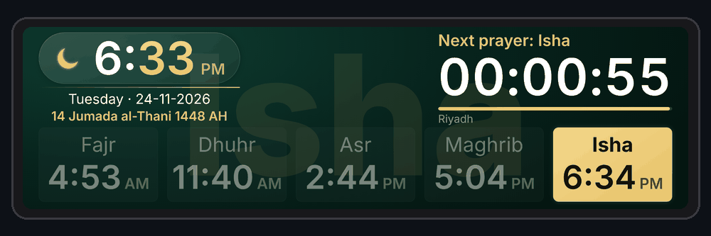

# Prayer Times Widget for CORSAIR XENEON EDGE



Prayer times on the CORSAIR XENEON EDGE, all in one widget. It shows the clock, the Gregorian and Hijri dates, the five daily prayers and a live countdown to the next prayer.

The countdown turns red during the last 30 seconds, and when the prayer time starts a small circle counts down 15 minutes to the iqama. In the widget settings you can choose your city, the prayer times source, the calculation method, the language and the background.

## Features

- Five daily prayers with a countdown and a progress bar to the next one
- Red countdown in the last 30 seconds, and an iqama circle for 15 minutes after each prayer time
- Gregorian and Hijri (Umm al-Qura) dates, 12 or 24 hour clock
- Three prayer times sources: AlAdhan, eSalah and an offline local calculation, with automatic fallback
- Location: automatic (device location, then internet, then time zone), 255 ready-made cities, or any city in 196 countries
- 10 calculation methods, with standard or Hanafi Asr
- 29 languages that follow your Windows language by default, including right-to-left languages
- Seven background themes that change with each prayer, one fixed theme, or a single custom color
- Four sizes: S, M, L and XL

## Screenshots

<table>
  <tr>
    <td><a href="screenshots/widget-S.png"></a></td>
    <td><a href="screenshots/widget-M.png"></a></td>
  </tr>
</table>
<table>
  <tr>
    <td><a href="screenshots/widget-L.png"></a></td>
    <td><a href="screenshots/widget-XL.png"></a></td>
  </tr>
</table>

## Installation

No extra software is needed.

1. Download the `.icuewidget` file from the link below and import it in iCUE (double-click it, or use Widgets and the + button)
2. Add it to your XENEON EDGE screen and pick the size you like
3. Open the widget settings and choose your city, or leave it on **Automatic**

If you installed an older build with the same version number, delete it in iCUE before importing the new one.

## Requirements

- iCUE 5.47 or newer
- Windows 10 or 11
- Internet connection for the online sources (the offline calculation works without it)

## Download

- [prayer-times-0.0.1.icuewidget](prayer-times-0.0.1.icuewidget)
- [Releases page](https://github.com/Nawaf-NM/Prayer-Times-Widget/releases)

## Notes

- **Location:** Automatic mode tries the device location first, then the internet (ipwho.is and geojs.io), then your Windows time zone. The widget shows which one was used under the countdown. For any other city choose **Other city**, pick the country and type the city name. Leave the name empty to use the capital.
- **Sources:** If the selected source fails, the widget switches to the offline calculation. You can turn this off in the settings. The eSalah source follows its published API and has not been tested yet.
- **Privacy:** Your city or coordinates are sent only to the services listed in the manifest (`api.aladhan.com`, `esalah.com`, `geocoding-api.open-meteo.com`, `ipwho.is` and `geojs.io`). The widget has no server of its own.
- **Build:** The widget source is in `src`. To package it, use the official CLI:

```
git clone --depth 1 https://github.com/Corsair-Labs/icuewidget-cli.git cli
node cli/node-bin/icuewidget.js validate ./src
node cli/node-bin/icuewidget.js package ./src
```

Made by [Nawaf AlMutairi](https://Nawaf-Blog.com/NM).
