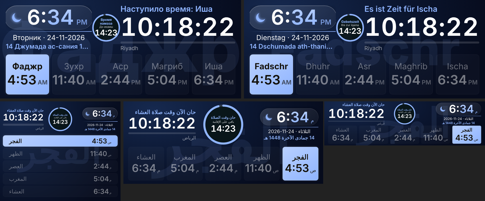

# Prayer Times Widget for CORSAIR XENEON EDGE

ويدجت مواقيت الصلاة لشاشة CORSAIR XENEON EDGE (iCUE). | Prayer times widget for iCUE.



## المزايا | Features

- الساعة والتاريخ الميلادي والهجري، والصلوات الخمس، وعدّاد تنازلي للصلاة القادمة مع شريط تقدم.
- يصبح العدّاد أحمر في آخر 30 ثانية قبل الصلاة.
- دائرة «حان وقت الصلاة / باقي على الإقامة» لمدة 15 دقيقة بعد دخول الوقت.
- خلفيات متغيرة مع كل صلاة، أو خلفية ثابتة، أو لون مخصص.
- مصادر المواقيت: AlAdhan، eSalah، وحساب محلي بدون إنترنت (مع رجوع تلقائي عند فشل المصدر).
- موقع تلقائي (موقع الجهاز ثم الإنترنت ثم المنطقة الزمنية)، أو اختيار من 255 مدينة، أو أي مدينة في 196 دولة.
- 29 لغة، تتبع لغة ويندوز افتراضيًا ويمكن تغييرها من الإعدادات.
- يدعم الأحجام S / M / L / XL.

## التثبيت | Install

1. حمّل `releases/prayer-times-0.0.1.icuewidget`.
2. افتح الملف بالنقر المزدوج، أو من iCUE: Widgets ثم +.
3. إن كنت قد ثبّتت إصدارًا سابقًا بنفس الرقم فاحذفه أولًا.

## الأذونات | Permissions

`api.aladhan.com`, `esalah.com`, `geocoding-api.open-meteo.com`, `ipwho.is`, `geojs.io` (HTTPS فقط).

## البناء | Build

```
git clone --depth 1 https://github.com/Corsair-Labs/icuewidget-cli.git cli
node cli/node-bin/icuewidget.js validate ./PrayerTimes
node cli/node-bin/icuewidget.js package ./PrayerTimes
```

## ملاحظات | Notes

- مصدر eSalah مبني على توثيقه المنشور ولم يُختبر فعليًا.
- الحساب المحلي قارنته بمواقيت AlAdhan في ثلاث مدن، والفرق دقيقة واحدة أو أقل.

## المطوّر | Developer

Nawaf AlMutairi - https://Nawaf-Blog.com/NM
